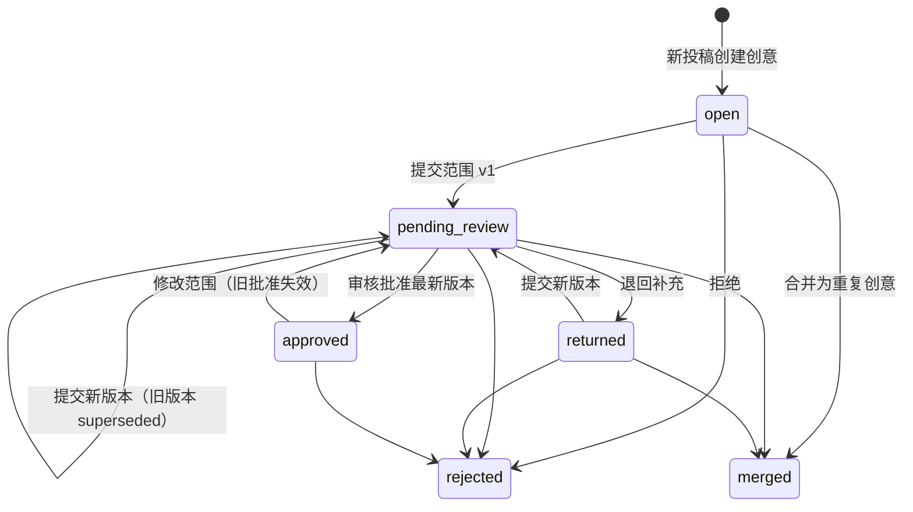

# 后端：投稿、合并与人工审核

范围：ROBB-9。AI 判断、Multica 立项/分配（ROBB-11）和真实抖音接入（ROBB-13）不在本模块内，下文给出它们接入时的契约。

## 核心规则与落实方式

| 规则 | 实现 |
|---|---|
| 原始投稿不丢失 | `submissions.raw_text`、来源、作者、接收时间、模板解析结果由触发器禁止修改；投稿行、范围版本、审核、合并、归属记录禁止删除 |
| 全部期望功能保留 | 投稿 `fields.desiredFeatures` 不限条数（上限 100）；创意详情 `desiredFeatures` 汇总所有来源投稿并标注来源 |
| 观众优先项 ≠ 本次范围 | `fields.viewerPriorities` 按原文保留（数量不强制）；本次范围在独立的 `scope_versions` 中 |
| 本次恰好三个功能及完成标准 | zod `length(3)` + 数据库检查函数 `workbench_valid_scope_features`，每项 `title`、`acceptanceCriteria` 非空 |
| 拒绝/退回不立项 | 只有 `ideas.status = 'approved'` 可立项；退回、拒绝均清空批准 |
| 改范围不沿用旧批准 | 范围版本内容不可修改；提交新版本会把旧的待审/批准版本标记为 `superseded`，创意回到 `pending_review`。数据库约束：`approved` 时 `approved_scope_version_id` 必须等于最新版本 |
| 并发与过期操作 | 提交范围需带 `baseVersionId`，审核需带 `scopeVersionId`，二者必须是当前最新版本，否则 `409 STALE_SCOPE_VERSION` |
| 消息级去重 | `(source, source_message_id)` 唯一；重复提交返回已有投稿（`200, deduplicated: true`），并发下由 advisory lock 串行化 |
| 重复创意合并可追溯 | `idea_merges` 记录合并；被合并创意所有投稿迁到目标（`origin → duplicate`），每条写 `submission_attributions`；被合并创意变为 `merged` 并作废其待审范围 |
| 补充反馈归属 | 单条投稿可作为 `feedback` 或 `duplicate` 归入其他创意并留归属记录；`feedback` 单独列出，不计入期望功能，不改变目标创意的范围或批准状态 |
| 模拟输入不冒充真实接入 | 人工接口只接受 `manual`/`sample`；`douyin` 来源只能由接入模块调用 `SubmissionService.ingest`；DTO 带 `isSimulated` |

## 状态机

`approved` 不能被合并走（可能已立项）；`rejected`、`merged` 是终态，不能接收合并或补充投稿。

## API

前缀 `/api`，JSON。请求 schema 与响应类型以 `packages/contracts/src/index.ts` 为准。

| 方法与路径 | 权限 | 说明 |
|---|---|---|
| `GET /me` | 任意 | 当前身份与角色 |
| `POST /submissions` | operator | 人工/示例投稿，按模板解析；可用 `fields` 覆盖解析结果 |
| `GET /submissions?source=&ideaId=&limit=&cursor=` | 任意 | 倒序分页 |
| `GET /submissions/:id` | 任意 | 含归属历史 `attributions` |
| `PATCH /submissions/:id/fields` | operator | 人工整理字段，留痕；原文不变 |
| `POST /submissions/:id/reattribute` | operator | 作为 `duplicate`/`feedback` 归入其他创意；创意首条投稿请改用创意合并（`USE_IDEA_MERGE`） |
| `GET /ideas?status=&status=&limit=&cursor=` | 任意 | 创意列表 |
| `GET /ideas/:id` | 任意 | 来源投稿、补充反馈、全部期望功能、范围版本、审核记录、合并记录、`launch` 立项就绪情况 |
| `POST /ideas/:id/merge` | operator | 整体合并到目标创意 |
| `POST /ideas/:id/scope-versions` | operator | 提交本次范围（恰好三项） |
| `POST /ideas/:id/reviews` | reviewer | `approve` / `return` / `reject` |
| `GET /events` | 任意 | SSE；事件只带 id，前端收到后重新拉取；断线后重新拉列表 |
| `GET /healthz` | 无需身份 | 存活与数据库连通 |

错误体：`{ error: { code, message, details? } }`，`code` 见契约 `ERROR_CODES`。

## 身份与权限

工作台部署在可信身份代理/私网之后，不内建登录。

- `AUTH_MODE=trusted-proxy`（默认）：代理注入 `x-workbench-user`、`x-workbench-roles`（逗号分隔：`operator`、`reviewer`）和共享密钥 `x-workbench-proxy-secret`；缺失或不匹配返回 401。密钥经部署环境的安全渠道配置，不进入仓库或任务评论。
- `AUTH_MODE=dev`：仅本机开发，缺省身份 `dev`（两种角色），可用同样的请求头模拟其他身份。

立项、分配、启动 agent 的权限属于 ROBB-11，届时扩展角色。

## 后续接手契约

**ROBB-11（AI 判断与 Multica 受控执行）**

- 立项前在同一事务内调用 `IdeaService.requireLaunchableScope(tx, ideaId)`：锁定创意行，返回已批准的最新范围；未批准、退回、拒绝、合并或范围已改动时抛 `NOT_LAUNCHABLE`。立项记录应关联返回的 `scopeVersion.id`，范围变更后旧立项依据随之失效。
- AI 判断结果、待审任务关联、立项/分配作业新增表与迁移即可（`src/migrations/002_*.sql`），不要修改本模块表的不变量。
- AI 只能给出合并/反馈归属和三功能建议；写入仍走本模块的人工接口与审核，AI 不持有 reviewer 角色。

**ROBB-13（真实抖音评论接入）**

- 验签通过后调用 `SubmissionService.ingest({ source: 'douyin', rawText, sourceMessageId, authorName, receivedAt }, actor)`；`sourceMessageId` 用平台消息 id 实现重复推送去重。回调 2 秒时限内只做验签与持久化。
- 多条补充按平台消息各自入库，再由人工用 `reattribute` 归属；不按昵称自动合并。

## 验证

`npm test` 在真实 PostgreSQL 上覆盖：模板解析、原文/全部期望保存、伪造抖音来源被拒、消息去重（含并发）、原文与删除的数据库层保护、重复合并与归属追溯、补充反馈不改变批准范围、范围恰好三项（含绕过 API 直写数据库）、改范围后旧批准失效与过期版本审核被拒、退回与拒绝不可立项、角色权限、SSE 事件。

## 尚未落实

- 真实抖音接入、AI 判断、Multica 立项/分配：分别属于 ROBB-13、ROBB-11。
- 部署环境、可信代理与共享密钥配置、数据保留期限：待 ROBB-8/ROBB-14。
