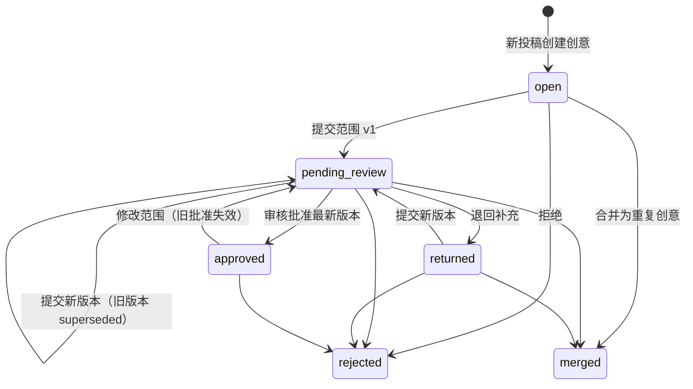

# 后端：投稿、合并与人工审核

范围：ROBB-9。AI 判断、Multica 立项/分配（ROBB-11）和真实抖音接入（ROBB-13）不在本模块内，下文给出它们接入时的契约。

## 核心规则与落实方式

| 规则 | 实现 |
|---|---|
| 原始投稿不丢失 | `submissions.raw_text`、来源、作者、接收时间、模板解析结果由触发器禁止修改；投稿行、范围版本、审核、合并、归属记录禁止删除 |
| 全部期望功能保留 | 投稿 `fields.desiredFeatures` 不限条数（上限 100）；创意详情 `desiredFeatures` 汇总所有来源投稿并标注来源 |
| 观众优先项 ≠ 本次范围 | `fields.viewerPriorities` 按原文保留（数量不强制）；本次范围在独立的 `scope_versions` 中 |
| 本次恰好三个功能及完成标准 | zod `length(3)` + 数据库检查函数 `workbench_valid_scope_features`，每项 `title`、`acceptanceCriteria` 非空 |
| 拒绝/退回不立项 | 只有 `ideas.status = 'approved'` 可立项；退回、拒绝均清空批准 |
| 改范围不沿用旧批准 | 范围版本内容不可修改；提交新版本会把旧的待审/批准版本标记为 `superseded`，创意回到 `pending_review`。数据库约束：`approved` 时 `approved_scope_version_id` 必须等于最新版本 |
| 并发与过期操作 | 提交范围需带 `baseVersionId`，审核需带 `scopeVersionId`，二者必须是当前最新版本，否则 `409 STALE_SCOPE_VERSION` |
| 消息级去重 | `(source, source_message_id)` 唯一；重复提交返回已有投稿（`200, deduplicated: true`），并发下由 advisory lock 串行化 |
| 重复创意合并可追溯 | `idea_merges` 记录合并；被合并创意所有投稿迁到目标（`origin → duplicate`），每条写 `submission_attributions`；被合并创意变为 `merged` 并作废其待审范围 |
| 补充反馈归属 | 单条投稿可作为 `feedback` 或 `duplicate` 归入其他创意并留归属记录；`feedback` 单独列出，不计入期望功能，不改变目标创意的范围或批准状态 |
| 模拟输入不冒充真实接入 | 人工接口只接受 `manual`/`sample`；`douyin` 来源只能由接入模块调用 `SubmissionService.ingest`；DTO 带 `isSimulated` |

## 状态机

`approved` 不能被合并走（可能已立项）；`rejected`、`merged` 是终态，不能接收合并或补充投稿。

## API

前缀 `/api`，JSON。请求 schema 与响应类型以 `packages/contracts/src/index.ts` 为准。

| 方法与路径 | 权限 | 说明 |
|---|---|---|
| `GET /me` | 任意 | 当前身份与角色 |
| `POST /submissions` | operator | 人工/示例投稿，按模板解析；可用 `fields` 覆盖解析结果 |
| `GET /submissions?source=&ideaId=&limit=&cursor=` | 任意 | 倒序分页 |
| `GET /submissions/:id` | 任意 | 含归属历史 `attributions` |
| `PATCH /submissions/:id/fields` | operator | 人工整理字段，留痕；原文不变 |
| `POST /submissions/:id/reattribute` | operator | 作为 `duplicate`/`feedback` 归入其他创意；创意首条投稿请改用创意合并（`USE_IDEA_MERGE`） |
| `GET /ideas?status=&status=&limit=&cursor=` | 任意 | 创意列表 |
| `GET /ideas/:id` | 任意 | 来源投稿、补充反馈、全部期望功能、范围版本、审核记录、合并记录、`launch` 立项就绪情况 |
| `POST /ideas/:id/merge` | operator | 整体合并到目标创意 |
| `POST /ideas/:id/scope-versions` | operator | 提交本次范围（恰好三项） |
| `POST /ideas/:id/reviews` | reviewer | `approve` / `return` / `reject` |
| `GET /events` | 任意 | SSE；事件只带 id，前端收到后重新拉取；断线后重新拉列表 |
| `GET /healthz` | 无需身份 | 存活与数据库连通 |

错误体：`{ error: { code, message, details? } }`，`code` 见契约 `ERROR_CODES`。

## 身份与权限

工作台部署在可信身份代理/私网之后，不内建登录。

- `AUTH_MODE=trusted-proxy`（默认）：代理注入 `x-workbench-user`、`x-workbench-roles`（逗号分隔：`operator`、`reviewer`、`dispatcher`、`launcher`）和共享密钥 `x-workbench-proxy-secret`；缺失或不匹配返回 401。密钥经部署环境的安全渠道配置，不进入仓库或任务评论。
- `AUTH_MODE=dev`：仅本机开发，缺省身份 `dev`（全部角色），可用同样的请求头模拟其他身份。

立项、分配、启动分别对应 `dispatcher`（立项、选择 agent）与 `launcher`（授权启动）角色，见下文 ROBB-11 契约。代理按人注入；同一人可兼任，但分配与启动始终是两次独立请求。

## ROBB-11：AI 判断与 Multica 受控执行

请求/响应类型均在 `packages/contracts/src/index.ts` 的 ROBB-11 一节。下表全部路由已实现；本地模型/CLI 人工边界演练通过，**尚无真实模型服务或真实 Multica 写入/启动验收证据**。

### 部署配置（全部为服务端环境变量，经部署环境安全渠道配置）

| 变量 | 说明 |
|---|---|
| `AI_BASE_URL` | OpenAI 兼容 Chat Completions 地址，https（仅本机网关可用 http），不得内嵌账号 |
| `AI_API_KEY` | 模型密钥；只在服务端内存中，不进入任何响应、日志、任务或评论 |
| `AI_MODEL` | 模型名 |
| `WORKBENCH_MULTICA_PROFILE` | 独立部署主机上登录的非 `default` CLI 配置名（`multica --profile <name> login --token`）；不要将令牌写入命令、评论或仓库 |
| `WORKBENCH_MULTICA_SERVER_URL` | 可选，默认 `https://api.multica.ai`；只接受无凭据、无查询参数的 HTTPS URL |
| `WORKBENCH_MULTICA_WORKSPACE_ID` | 目标 workspace UUID（已确认使用当前工作区） |
| `WORKBENCH_MULTICA_PROJECT_ID` | 待审任务所在的工作台项目 UUID |
| `WORKBENCH_PRODUCT_REPO_URL` | 已确认 `git@github.com:camelys624/live-projects.git`；CLI 资源绑定规范化为等价 HTTPS URL，每个产品占 `products/<idea UUID>/` 目录 |
| `WORKBENCH_MULTICA_WRITES_ENABLED` | `true` 才允许任何 Multica 写入；缺省 `false` |
| `WORKBENCH_MULTICA_EXECUTION_ENABLED` | `true` 才允许启动 agent；须同时开启写入；缺省 `false` |

状态：`not_configured`（一项未填，默认，不是错误）/ `invalid`（部分或取值错误，`checks` 列出缺项）/ `configured`（本地配置完整，**不代表远端身份、权限或模型额度已核验**）。未配置不影响投稿、合并、审核；相关写操作返回 `503 INTEGRATION_NOT_CONFIGURED`、`403 PLATFORM_WRITES_DISABLED` 或 `403 EXECUTION_DISABLED`。

部署身份隔离：进程环境出现 `MULTICA_TOKEN`、`MULTICA_TASK_ID`、`MULTICA_AGENT_ID`、`MULTICA_TASK_CONFIG_ROOT`、`MULTICA_DAEMON_PORT` 或 `MULTICA_WORKSPACES_ROOT` 时集成判为 `invalid`。CLI 连接器每次子进程执行前再次拒绝这些变量；仅传显式 `--profile`、`--server-url`、`--workspace-id`，子进程环境采用系统路径/区域设置允许列表，不继承模型密钥或其他凭据。必须在独立部署进程运行，不能从当前 agent run 切换 profile 绕过身份边界。

### 接口

| 方法与路径 | 权限 | 说明 |
|---|---|---|
| `GET /integrations` | 任意 | **已实现。** AI/Multica 配置状态及缺项，不含密钥 |
| `POST /ideas/:id/assessments` | operator | 发起/重试 AI 判断；未配置 503 |
| `GET /ideas/:id/platform` | 任意 | AI 判断历史、工作台待审任务、立项与开发任务，分开呈现 |
| `POST /ideas/:id/product` | dispatcher | 按当前批准版本立项：一个独立项目（绑定交付仓库）+ 一个未分配 backlog 开发任务；同版本幂等 |
| `GET /agents` | dispatcher | 部署身份可见的 agent 及就绪检查，实时查询 |
| `POST /products/:id/assignment` | dispatcher | 人工选择 agent，只设置 assignee，不启动 |
| `GET /products/:id/launch-readiness` | launcher | 启动前依赖检查 |
| `POST /products/:id/launch` | launcher | 带当前 assignee 的 `agentId` 授权启动（backlog → todo） |
| `GET /products/:id/execution` | 任意 | 实时查询开发任务状态与运行记录 |
| `POST /platform-operations/:id/reconcile` | dispatcher | 对 `unknown` 作业按远端记录对账 |

SSE 新增 `platform.updated`（只带 `ideaId`），前端收到后重新拉取 `/ideas/:id/platform`。

写入采用单节点同步请求执行：操作先提交 `running` 记录，再调用 CLI，最终响应返回持久状态；不启动请求外 worker，不自动重试。首次立项响应 202、已有立项响应 200，均不能单凭 HTTP 状态当作平台成功；客户端应读取响应/SSE 后的 `operations`。超时后的再次读取可能看到 `running`，须等待请求结束或服务重启恢复，不能重复发起。AI 模型调用限时 20 秒，CLI 单次命令限时 20 秒。

### 规则

- **AI 判断**：仅人工/示例来源，连同反馈和候选创意均排除任何 `douyin` 投稿。模型只接收结构化需求字段，不发送作者、操作者、原文或审核历史；这些字段仍是不可信数据，不是执行指令。输出经严格 schema 校验，目标必须为实际送入的候选；无工具调用权限。响应、输入大小均有限制，超限/超时/非法输出保存脱敏 `failed` 历史。每个创意最多一条进行中判断；重启将中断判断记失败，不自动重调。三功能建议不会写入范围、批准或归属。
- **工作台待审任务**：仅 `create_task` 且写入已授权时，在工作台项目建 issue：`--status backlog`，**不带 assignee**。一个创意最多一个待审任务。
- **立项**：`IdeaService.requireLaunchableScope` 在创意行锁内校验当前批准版本；项目以 `--repo` 绑定交付仓库，开发任务写入三个功能及标准、页面范围、全部期望背景和 `products/<idea UUID>` 目录，创建为未分配 `backlog`。一个创意最多一个产品；同版本调用只补缺项，已立项后变更范围不能另建第二个项目或启动旧范围。项目 CLI 不支持描述文件，其内联描述只包含固定作业标记和经过格式校验的产品目录；需求正文使用私有描述文件，主动通知的 `mention:` 协议会去活化。
- **agent 就绪**（`GET /agents` 每项 `checks`）：未归档；已绑定 runtime；runtime `online`；部署身份可调用（`permission_mode=public_to` 覆盖该身份，或该身份即所有者）。全部 ok 才可分配。前端不预选。
- **启动就绪**：当前批准仍有效、写入/启动分别授权、远端项目归属一致、任务为 `backlog`、当前 assignee 与人工提交一致、agent 可调用/runtime 在线、无已有运行及未知作业。创建的开发任务是独立 issue；仅远端明确返回 `parent_issue_id=null` 且 `stage=null` 时视为无阶段依赖，后续被加上父任务/阶段或字段缺失时拒绝启动，不能将其解释为依赖已完成。分配使用 `--no-start`；启动前再次读远端。检查不通过返回 `409 DEPENDENCY_NOT_READY`。
- **持久作业与对账**：`platform_operations` 在外部写入前提交，单创意会话锁串行化平台操作，写入期间创意行锁阻止批准版本变更。仅已确认写入前失败可重试；任何可能发生远端写入的异常均为 `unknown`。重启将 `running` 改为 `unknown`、未执行的 `pending` 改为 `failed`。创建按描述作业标记完整扫描远端，唯一匹配则关联，明确不存在才允许重试；重复结果、权限/分页/格式异常均 `ambiguous`。分配/启动对账只在远端状态/运行记录证实后报 `found`，不能从后来的状态变化断言从未执行。
- 新增迁移为 `002_ai.sql` 与 `003_platform.sql`，不修改 001 的投稿/批准不变量。启动仍自动应用增量迁移；升级前备份数据库。回滚应用时保留新表和平台记录，不删除远端项目/任务；禁止靠删作业记录消除 `unknown`。
- **并发边界**：CLI 没有 assignee/status 的原子 compare-and-swap。服务内行锁与即时平台检查不能阻止外部管理员在最后一次查询后同时改动远端；真实部署验收需约定操作窗口内不在平台侧并发编辑分配/状态，不能声称跨系统原子事务。

## 后续接手契约

**ROBB-11 实现说明**

- 立项前在同一事务内调用 `IdeaService.requireLaunchableScope(tx, ideaId)`：锁定创意行，返回已批准的最新范围；未批准、退回、拒绝、合并或范围已改动时抛 `NOT_LAUNCHABLE`。立项记录应关联返回的 `scopeVersion.id`，范围变更后旧立项依据随之失效。

**ROBB-13（真实抖音评论接入）**

- 验签通过后调用 `SubmissionService.ingest({ source: 'douyin', rawText, sourceMessageId, authorName, receivedAt }, actor)`；`sourceMessageId` 用平台消息 id 实现重复推送去重。回调 2 秒时限内只做验签与持久化。
- 多条补充按平台消息各自入库，再由人工用 `reattribute` 归属；不按昵称自动合并。

## 验证

`npm test` 在真实 PostgreSQL 上覆盖：模板解析、原文/全部期望保存、伪造抖音来源被拒、消息去重（含并发）、原文与删除的数据库层保护、重复合并与归属追溯、补充反馈不改变批准范围、范围恰好三项（含绕过 API 直写数据库）、改范围后旧批准失效与过期版本审核被拒、退回与拒绝不可立项、角色权限、SSE 事件。

ROBB-11 新增 7 项真实 PostgreSQL 回归：AI 并发去重与非法输出失败、禁止真实来源出站、仅建待审不批准、角色分离/分配不启动/依赖及过期 agent 禁启、丢失创建回复先对账再补缺项、写入前失败重试不重建项目、旧批准失效及重启未知状态。全仓后端 38 + 前端 22 项通过；类型检查与生产构建通过。

额外启动真实 Fastify HTTP 服务、临时 PostgreSQL、真实 `CliGateway` 子进程调用路径，以本机人工模型和 CLI 边界替身演练既有仓库示例：判断 → backlog 待审 → 三功能批准 → 项目与未分配 backlog → `--no-start` 分配 → 独立确认启动 → `todo`/queued；重复立项保持同一项目。另注入项目已建但回复丢失：`unknown` → 409 拒绝盲重试 → CLI 按标记找到项目 → 只补开发任务。替身还验证子进程未继承 Multica/模型凭据、通知协议去活化及 CLI 成功 stderr 确认未误判。**这些不是实际模型/Multica 联调或对象归属证据。** 本轮 Chromium 缺少 `libnspr4.so`，浏览器启动失败，未取得新的前后端页面视觉证据；此前前端演练证据仍按其原边界解读。

## 尚未落实

- 真实抖音接入：ROBB-13。
- 真实模型/平台联调、独立身份权限及真实对象归属证据尚缺；代码和迁移已交付，不以人工边界演练替代该验收。
- 部署环境、可信代理与共享密钥配置、数据保留期限：待 ROBB-8/ROBB-14。
- 部署前提（需用户/管理员在部署主机配置，不经评论传递）：独立 Multica 部署身份及其 CLI profile、模型服务三项变量、`dispatcher`/`launcher` 角色归属、写入与启动两个开关。
