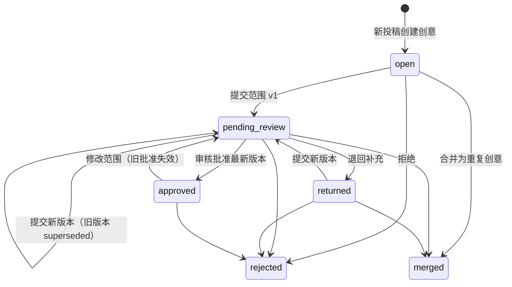

# 后端：投稿、合并与人工审核

范围：ROBB-9。AI 判断、Multica 立项/分配（ROBB-11）和真实抖音接入（ROBB-13）不在本模块内，下文给出它们接入时的契约。

## 核心规则与落实方式

| 规则 | 实现 |
|---|---|
| 原始投稿不丢失 | `submissions.raw_text`、来源、作者、接收时间、模板解析结果由触发器禁止修改；投稿行、范围版本、审核、合并、归属记录禁止删除 |
| 全部期望功能保留 | 投稿 `fields.desiredFeatures` 不限条数（上限 100）；创意详情 `desiredFeatures` 汇总所有来源投稿并标注来源 |
| 观众优先项 ≠ 本次范围 | `fields.viewerPriorities` 按原文保留（数量不强制）；本次范围在独立的 `scope_versions` 中 |
| 本次恰好三个功能及完成标准 | zod `length(3)` + 数据库检查函数 `workbench_valid_scope_features`，每项 `title`、`acceptanceCriteria` 非空 |
| 拒绝/退回不立项 | 只有 `ideas.status = 'approved'` 可立项；退回、拒绝均清空批准 |
| 改范围不沿用旧批准 | 范围版本内容不可修改；提交新版本会把旧的待审/批准版本标记为 `superseded`，创意回到 `pending_review`。数据库约束：`approved` 时 `approved_scope_version_id` 必须等于最新版本 |
| 并发与过期操作 | 提交范围需带 `baseVersionId`，审核需带 `scopeVersionId`，二者必须是当前最新版本，否则 `409 STALE_SCOPE_VERSION` |
| 消息级去重 | `(source, source_message_id)` 唯一；重复提交返回已有投稿（`200, deduplicated: true`），并发下由 advisory lock 串行化 |
| 重复创意合并可追溯 | `idea_merges` 记录合并；被合并创意所有投稿迁到目标（`origin → duplicate`），每条写 `submission_attributions`；被合并创意变为 `merged` 并作废其待审范围 |
| 补充反馈归属 | 单条投稿可作为 `feedback` 或 `duplicate` 归入其他创意并留归属记录；`feedback` 单独列出，不计入期望功能，不改变目标创意的范围或批准状态 |
| 模拟输入不冒充真实接入 | 人工接口只接受 `manual`/`sample`；`douyin` 来源只能由接入模块调用 `SubmissionService.ingest`；DTO 带 `isSimulated` |

## 状态机

`approved` 不能被合并走（可能已立项）；`rejected`、`merged` 是终态，不能接收合并或补充投稿。

## API

前缀 `/api`，JSON。请求 schema 与响应类型以 `packages/contracts/src/index.ts` 为准。

| 方法与路径 | 权限 | 说明 |
|---|---|---|
| `GET /me` | 任意 | 当前身份与角色 |
| `POST /submissions` | operator | 人工/示例投稿，按模板解析；可用 `fields` 覆盖解析结果 |
| `GET /submissions?source=&ideaId=&limit=&cursor=` | 任意 | 倒序分页 |
| `GET /submissions/:id` | 任意 | 含归属历史 `attributions` |
| `PATCH /submissions/:id/fields` | operator | 人工整理字段，留痕；原文不变 |
| `POST /submissions/:id/reattribute` | operator | 作为 `duplicate`/`feedback` 归入其他创意；创意首条投稿请改用创意合并（`USE_IDEA_MERGE`） |
| `GET /ideas?status=&status=&limit=&cursor=` | 任意 | 创意列表 |
| `GET /ideas/:id` | 任意 | 来源投稿、补充反馈、全部期望功能、范围版本、审核记录、合并记录、`launch` 立项就绪情况 |
| `POST /ideas/:id/merge` | operator | 整体合并到目标创意 |
| `POST /ideas/:id/scope-versions` | operator | 提交本次范围（恰好三项） |
| `POST /ideas/:id/reviews` | reviewer | `approve` / `return` / `reject` |
| `GET /events` | 任意 | SSE；事件只带 id，前端收到后重新拉取；断线后重新拉列表 |
| `GET /healthz` | 无需身份 | 存活与数据库连通 |

错误体：`{ error: { code, message, details? } }`，`code` 见契约 `ERROR_CODES`。

## 身份与权限

工作台部署在可信身份代理/私网之后，不内建登录。

- `AUTH_MODE=trusted-proxy`（默认）：代理注入 `x-workbench-user`、`x-workbench-roles`（逗号分隔：`operator`、`reviewer`、`dispatcher`、`launcher`）和共享密钥 `x-workbench-proxy-secret`；缺失或不匹配返回 401。密钥经部署环境的安全渠道配置，不进入仓库或任务评论。
- `AUTH_MODE=dev`：仅本机开发，缺省身份 `dev`（全部角色），可用同样的请求头模拟其他身份。

立项、分配、启动分别对应 `dispatcher`（立项、选择 agent）与 `launcher`（授权启动）角色，见下文 ROBB-11 契约。代理按人注入；同一人可兼任，但分配与启动始终是两次独立请求。

## ROBB-11：AI 判断与 Multica 受控执行

请求/响应类型均在 `packages/contracts/src/index.ts` 的 ROBB-11 一节。**已实现：配置读取与 `GET /api/integrations`**；其余路由为已定契约、待实现，实现前返回 404，前端保持禁用。

### 部署配置（全部为服务端环境变量，经部署环境安全渠道配置）

| 变量 | 说明 |
|---|---|
| `AI_BASE_URL` | OpenAI 兼容 Chat Completions 地址，https（仅本机网关可用 http），不得内嵌账号 |
| `AI_API_KEY` | 模型密钥；只在服务端内存中，不进入任何响应、日志、任务或评论 |
| `AI_MODEL` | 模型名 |
| `WORKBENCH_MULTICA_PROFILE` | 部署主机上独立登录的 Multica CLI 配置名（`multica --profile <name> login --token`） |
| `WORKBENCH_MULTICA_SERVER_URL` | 可选，默认 `https://api.multica.ai` |
| `WORKBENCH_MULTICA_WORKSPACE_ID` | 目标 workspace UUID（已确认使用当前工作区） |
| `WORKBENCH_MULTICA_PROJECT_ID` | 待审任务所在的工作台项目 UUID |
| `WORKBENCH_PRODUCT_REPO_URL` | 小产品交付仓库（已确认 `git@github.com:camelys624/live-projects.git`）；每个产品占 `products/<序号>-<slug>/` 目录 |
| `WORKBENCH_MULTICA_WRITES_ENABLED` | `true` 才允许任何 Multica 写入；缺省 `false` |
| `WORKBENCH_MULTICA_EXECUTION_ENABLED` | `true` 才允许启动 agent；须同时开启写入；缺省 `false` |

状态：`not_configured`（一项未填，默认，不是错误）/ `invalid`（部分或取值错误，`checks` 列出缺项）/ `configured`（本地配置完整，**不代表远端身份、权限或模型额度已核验**）。未配置不影响投稿、合并、审核；相关写操作返回 `503 INTEGRATION_NOT_CONFIGURED`、`403 PLATFORM_WRITES_DISABLED` 或 `403 EXECUTION_DISABLED`。

部署身份隔离：进程环境出现 `MULTICA_TASK_ID`、`MULTICA_TASK_CONFIG_ROOT` 或 `mat_` 开头的 `MULTICA_TOKEN`（即运行在某个 agent run 内）时，Multica 集成判为 `invalid`，写入和启动均关闭。连接器调用 CLI 时只传 `--profile`、`--workspace-id`，并清除上述变量，不读取运行时所有者的默认配置。

### 接口

| 方法与路径 | 权限 | 说明 |
|---|---|---|
| `GET /integrations` | 任意 | **已实现。** AI/Multica 配置状态及缺项，不含密钥 |
| `POST /ideas/:id/assessments` | operator | 发起/重试 AI 判断；未配置 503 |
| `GET /ideas/:id/platform` | 任意 | AI 判断历史、工作台待审任务、立项与开发任务，分开呈现 |
| `POST /ideas/:id/product` | dispatcher | 按当前批准版本立项：一个独立项目（绑定交付仓库）+ 一个未分配 backlog 开发任务；同版本幂等 |
| `GET /agents` | dispatcher | 部署身份可见的 agent 及就绪检查，实时查询 |
| `POST /products/:id/assignment` | dispatcher | 人工选择 agent，只设置 assignee，不启动 |
| `GET /products/:id/launch-readiness` | launcher | 启动前依赖检查 |
| `POST /products/:id/launch` | launcher | 带当前 assignee 的 `agentId` 授权启动（backlog → todo） |
| `GET /products/:id/execution` | 任意 | 实时查询开发任务状态与运行记录 |
| `POST /platform-operations/:id/reconcile` | dispatcher | 对 `unknown` 作业按远端记录对账 |

SSE 新增 `platform.updated`（只带 `ideaId`），前端收到后重新拉取 `/ideas/:id/platform`。

### 规则

- **AI 判断**：只处理 `isSimulated` 投稿（`dataScope: simulated_only`）；`douyin` 来源在 ROBB-12 用途获准前不送模型、不建任务。投稿原文作为不可信数据放入模型输入，输出只接受契约内的结构化字段，非法输出记 `failed`。判断为 `duplicate`/`feedback` 只给出建议目标，归属仍走人工 `reattribute`/`merge`；三功能建议不构成范围或批准。
- **工作台待审任务**：仅 `create_task` 且写入已授权时，在工作台项目建 issue：`--status backlog`，**不带 assignee**。一个创意最多一个待审任务。
- **立项**：事务内调用 `IdeaService.requireLaunchableScope` 锁定批准版本；项目以 `--repo` 绑定交付仓库，开发任务描述写入本次三个功能及完成标准、页面范围、`products/<序号>-<slug>/` 交付目录，`--status backlog`、无 assignee。同一批准版本重复调用返回已有立项，只补齐失败缺项。
- **agent 就绪**（`GET /agents` 每项 `checks`）：未归档；已绑定 runtime；runtime `online`；部署身份可调用（`permission_mode=public_to` 覆盖该身份，或该身份即所有者）。全部 ok 才可分配。前端不预选。
- **启动就绪**（`launch-readiness`）：写入与启动授权均开启；立项依据仍是当前批准版本；开发任务已存在且远端仍为 `backlog`；远端 assignee 等于请求 `agentId`；该 agent 当前满足上一条；无 `unknown` 作业。任一不满足返回 `409 DEPENDENCY_NOT_READY`，`details` 为检查项。
- **持久作业与对账**：每次 Multica 写入先写 `platform_operations`（含幂等键）再执行；成功记录远端 id。超时/进程中断记 `unknown`，同一对象在对账前拒绝重试（`409 OPERATION_UNKNOWN`）；对账按幂等键查远端：找到则关联、确认不存在才允许重试、无法判断交人工。
- 新增表放在 `src/migrations/002_*.sql`，不修改 001 的不变量；AI 和连接器都不持有任何工作台角色。

## 后续接手契约

**ROBB-11 实现说明**

- 立项前在同一事务内调用 `IdeaService.requireLaunchableScope(tx, ideaId)`：锁定创意行，返回已批准的最新范围；未批准、退回、拒绝、合并或范围已改动时抛 `NOT_LAUNCHABLE`。立项记录应关联返回的 `scopeVersion.id`，范围变更后旧立项依据随之失效。

**ROBB-13（真实抖音评论接入）**

- 验签通过后调用 `SubmissionService.ingest({ source: 'douyin', rawText, sourceMessageId, authorName, receivedAt }, actor)`；`sourceMessageId` 用平台消息 id 实现重复推送去重。回调 2 秒时限内只做验签与持久化。
- 多条补充按平台消息各自入库，再由人工用 `reattribute` 归属；不按昵称自动合并。

## 验证

`npm test` 在真实 PostgreSQL 上覆盖：模板解析、原文/全部期望保存、伪造抖音来源被拒、消息去重（含并发）、原文与删除的数据库层保护、重复合并与归属追溯、补充反馈不改变批准范围、范围恰好三项（含绕过 API 直写数据库）、改范围后旧批准失效与过期版本审核被拒、退回与拒绝不可立项、角色权限、SSE 事件。

## 尚未落实

- 真实抖音接入：ROBB-13。
- ROBB-11 除 `GET /integrations` 外的路由与 002 迁移；真实平台写入须等下列部署前提落实后才在真实环境验收。
- 部署环境、可信代理与共享密钥配置、数据保留期限：待 ROBB-8/ROBB-14。
- 部署前提（需用户/管理员在部署主机配置，不经评论传递）：独立 Multica 部署身份及其 CLI profile、模型服务三项变量、`dispatcher`/`launcher` 角色归属、写入与启动两个开关。
